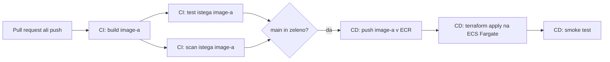

# devops-project

Majhen HTTP projekt s avtomatizirano potjo do produkcije: vsaka sprememba se zbuilda, testira in deploya prek CI/CD pipeline-a.

> **Status: faza načrtovanja.** Specifikacija in zapisi odločitev so napisani, storitev, pipeline in infrastruktura pa še niso izdelani. Kaj točno obstaja, piše v [12. razdelku specifikacije](docs/SPEC.md#12-status).

## Kaj dela

`GET /<accountId>/data` vrne:

```json
{
  "accountId": "acme-42",
  "timestamp": 1767323045,
  "data": "9f2c1e5a7b0d4c3e8a6f1b2d3c4e5f60"
}
```

## CI/CD



Stack: Go, Docker, GitHub Actions, Terraform, AWS (ECR, ECS Fargate, ALB, CloudWatch).

## Dokumentacija

- **[Specifikacija](docs/SPEC.md):** načrt po korakih s povezavami na vire.
- **[Zapisi odločitev](docs/ODLOCITVE.md):** zakaj sem se za posamezno stvar odločil in kaj sem še pretehtal.
- [Izvirna naloga](docs/DevOps_Homework.pdf).

## Načrtovana struktura repozitorija

| Pot                  | Vsebina                                                                   |
| -------------------- | ------------------------------------------------------------------------- |
| `app/`               | Storitev v Go, testi in Dockerfile                                        |
| `infra/bootstrap/`   | Enkratni Terraform: bucket za state, GitHub OIDC provider, role za deploy |
| `infra/service/`     | Terraform, ki ga poganja pipeline: network, ECR, ECS, ALB, alarmi         |
| `.github/workflows/` | `ci.yml` in `cd.yml`                                                      |

## Zagon

Dopolnim med implementacijo: lokalni zagon, testi in enkratni koraki za bootstrap.
