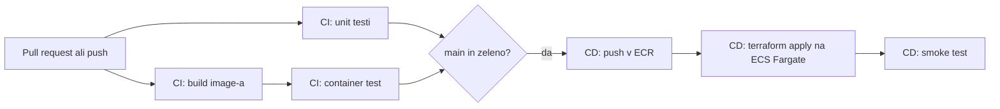

# devops-project

Majhna HTTP storitev v Go z avtomatizirano potjo do produkcije: vsaka sprememba se zgradi, testira in (po zasnovi) deploya prek CI/CD pipeline-a na AWS.

> **Kaj je zares zagnano:** storitev, image in CI na GitHubu. Terraform je napisan in validiran, **ni pa bil nikoli apply-an**, CD pa je napisan in **trajno izklopljen**, ker nimam AWS accounta. Podrobnosti: [status](docs/SPEC.md#2-status).

## Kaj dela

`GET /<accountId>/data` vrne:

```json
{
  "accountId": "acme-42",
  "timestamp": 1767323045,
  "data": "9f2c1e5a7b0d4c3e8a6f1b2d3c4e5f60"
}
```

## Pipeline



CI (zgornji del) teče na GitHubu. CD (spodnji del) je napisan, a izklopljen.

## Dokumentacija

- **[Specifikacija in odločitve](docs/SPEC.md):** povzetek, status, arhitektura, odločitve in viri. Začni tu.
- [Izvirna naloga](docs/DevOps_Homework.pdf).

## Zagon

Potrebuješ Go (verzija iz `go.mod`) in Docker.

```bash
go test -race ./...                                      # unit testi
docker build -f image/Dockerfile -t data-service:dev .   # image
docker run --rm -p 8080:8080 data-service:dev            # zagon
bash scripts/check-service.sh http://localhost:8080
```

Terraform se preveri brez AWS accounta:

```bash
cd infra/service && terraform init -backend=false && terraform validate
```

## Struktura

| Pot                  | Vsebina                                                         |
| -------------------- | --------------------------------------------------------------- |
| `cmd/`               | Storitev v Go in testi (`go.mod` je v korenu)                   |
| `image/`             | Dockerfile                                                      |
| `scripts/`           | `check-service.sh`: preveri pogodbo storitve (CI in smoke test) |
| `infra/service/`     | Terraform, ki ga poganja pipeline: omrežje, ALB, ECS, alarmi    |
| `infra/bootstrap/`   | Enkratni Terraform. V kodi je zaenkrat samo ECR repozitorij     |
| `.github/workflows/` | `ci.yml` in `cd.yml` (izklopljen)                               |
| `docs/`              | Specifikacija z odločitvami                                     |
