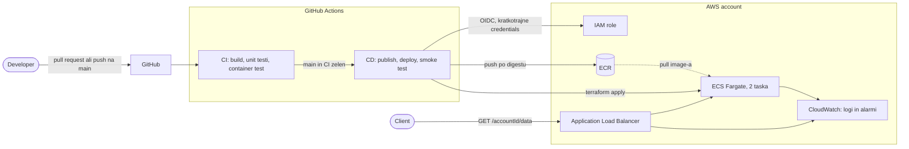

# Specifikacija: storitev z avtomatiziranim CI/CD

## 1. Povzetek

Naredil sem majhno HTTP storitev v Go, pri kateri gre vsaka sprememba na `main` skozi CI/CD pipeline: build, testi in deploy v production na AWS (ECS Fargate). Naloga ([PDF](DevOps_Homework.pdf)) ima štiri zahteve:

| # | Zahteva | Kako sem jo rešil |
| --- | --- | --- |
| 1 | GET `/<accountId>/data` z JSON odgovorom in testi pred productionom | Go storitev, unit testi in container test v CI ([3](#3-storitev-in-image), [4](#4-cicd)) |
| 2 | Vse v enem Docker image-u, brez dependencies in trajnega shranjevanja | Multi-stage build, statičen binary v distroless image-u ([3](#3-storitev-in-image)) |
| 3 | CI zgradi image in požene teste, ločena koraka | Job `build` zgradi image enkrat, drugi jobi preverijo isti image ([4](#4-cicd)) |
| 4 | CD po uspešnem CI deploya v production | `cd.yml` in Terraform. **Napisano, a ne izvedeno** ([4](#4-cicd), [5](#5-infrastruktura)) |



**Potek:** pull request požene samo CI. Po merge-u na `main` CD objavi **isti image, ki je prestal teste**, ga s Terraformom deploya na ECS in preveri delujočo storitev. Če novi taski ne postanejo healthy, ECS samodejno naredi rollback.

## 2. Status

Kar je označeno kot zagnano, sem res zagnal. Česar nisem, je izrecno povedano.

| Del | Status |
| --- | --- |
| Storitev in 11 unit testov | **Zagnano**: lokalno in v CI |
| Docker image | **Zagnano**: zgrajen in zagnan lokalno, zgrajen v CI |
| CI (build, unit testi, container test) | **Zagnano na GitHubu**, vsi trije jobi uspešni |
| Terraform `infra/service`, ECR v `infra/bootstrap` | Napisano. `terraform fmt` in `validate` uspeta. **Nikoli `plan` ali `apply`**, ker nimam AWS accounta |
| Preostanek bootstrapa (state bucket, OIDC provider, deploy role) | Samo opisano |
| CD workflow | Napisan, **trajno izklopljen** (`if: false`), ni preverjen z orodjem |
| Trivy scan, Dependabot | Nisem naredil zaradi časa ([7](#7-nadaljnje-izboljšave)) |

Zato ne morem trditi, da AWS sprejme konfiguracijo (imena, IAM pravice, kvote). `validate` preveri samo sintakso in reference med resource-i.

## 3. Storitev in image

| Pot | Obnašanje |
| --- | --- |
| `GET /{accountId}/data` | JSON spodaj, status 200 |
| `GET /healthz` | 200 `ok`; uporablja ga load balancer |
| vse ostalo | 404, napačna metoda na znani poti 405 |

```json
{ "accountId": "acme-42", "timestamp": 1767323045, "data": "9f2c1e5a7b0d4c3e8a6f1b2d3c4e5f60" }
```

JSON logi gredo na stdout, port je iz `PORT` (privzeto 8080), ob SIGTERM storitev elegantno konča (graceful shutdown), da deploy ne prekine zahtevkov v teku.

**Image:** multi-stage Dockerfile. Statičen build (`CGO_ENABLED=0`) v `golang` image-u, nato samo binary v `gcr.io/distroless/static-debian12:nonroot`. Image nima shella ne package managerja in teče kot non-root user. Oba base image-a sta **pinnana na digest**, zato je build ponovljiv in premaknjen tag ne more nič spremeniti.

**Odločitve:**

- **Go, samo standardna knjižnica.** Storitev vrne le majhen JSON, bistvo naloge sta pipeline in infrastruktura. Go da statičen binary in nič dependencies za pinnanje. Zavrnjeno: Python (dependencies in runtime v image-u), Scala (težak JVM image), PHP (brez prednosti).
- **`timestamp` je Unix time v sekundah** (JSON število). Je definiran glede na UTC, zato ni dvoumnosti, naloga pa ga kaže brez narekovajev. Zavrnjeno: ISO 8601 niz in milisekunde.
- **`accountId` mora ustrezati `^[A-Za-z0-9_-]{1,64}$`, sicer 400.** Ker ga vračam v odgovoru, ne vračam poljubnega vnosa. `data` je 16 naključnih bajtov iz `crypto/rand`, zapisanih v hex.

## 4. CI/CD

### CI

Workflow `ci.yml` teče ob vsakem pull requestu in pushu na `main`.

| Job | Kaj naredi | Kaj dokaže |
| --- | --- | --- |
| `build` | Enkrat zgradi image in ga naloži kot artifact | Image se zgradi |
| `container-test` (potrebuje `build`) | Naloži **isti artifact**, preveri da ne teče kot root, ga zažene in požene `scripts/check-service.sh` | Image deluje in drži dogovorjeni JSON, vključno z 400, 404 in 405 |
| `test` | `gofmt`, `go vet`, `go test -race` | Obnašanje handlerjev in validacija |

Actions so pinnane na **commit SHA**, workflow ima samo `contents: read`. Isti script `check-service.sh` služi tudi kot smoke test po deployu, zato je pogodba preverjena na enem mestu.

### CD

Workflow `cd.yml` se sproži, ko se CI konča na `main`, in verigi tri jobe:

| Job | Kaj naredi |
| --- | --- |
| `publish` | Vzame artifact iz CI runa (ne gradi znova), ga pushne v ECR in prebere **digest** |
| `deploy` | `terraform plan`, nato `apply` istega plana z digestom kot vhodom |
| `smoke-test` | Požene `check-service.sh` na naslovu ALB |

`wait_for_steady_state` naredi, da `apply` počaka na healthy taske. Če ECS naredi rollback, `apply` pade in z njim workflow. `concurrency` group omeji deploy na enega naenkrat.

**Napisano, a nikoli zagnano.** Job `publish` ima trdo zapisan `if: false`, ostala dva sta odvisna od njega, zato workflow ne more ničesar deployati.

**Kaj bi naredil pred prvim deployem:**

1. Ročno poženem `infra/bootstrap` (ECR, state bucket, OIDC provider, deploy role).
2. V GitHubu ustvarim environment `production` in repository variables `AWS_ROLE_ARN` ter `TF_STATE_BUCKET`.
3. Zamenjam `if: false` s pogojem, ki je zapisan v komentarju nad njim.
4. Po preizkusu stack odstranim (`terraform destroy`), ker ALB in taski stanejo, dokler tečejo.

**Odločitve:**

- **Build enkrat, deploy po digestu.** Če bi vsak korak gradil znova, bi se testirano lahko razlikovalo od deployanega. Digest določa natanko en image, tage pa je mogoče premakniti. Zavrnjeno: ponoven build v vsakem koraku in testiranje iz registry-ja (netestirani image-i bi bili v registry-ju).
- **GitHub OIDC namesto AWS ključev.** Shranjeni ključi so dolgoživi in lahko uidejo, OIDC token je kratkotrajen. Trust policy role-a dovoli samo ta repozitorij in environment `production`. Zavrnjeno: access keys v secrets, self-hosted runnerji.
- **CD napisan, a trajno izklopljen.** Brez AWS accounta ga ne morem preizkusiti, vklopljen pa bi se po vsakem CI-ju sprožil in padel. Pogoj je v datoteki, ne v nastavitvi, da ga po pomoti ne more vklopiti nič drugega. Zavrnjeno: vklop prek repository variable in brez workflowa (manjkal bi del, ki ga naloga zahteva).

## 5. Infrastruktura

Vsa infrastruktura je v Terraformu, v dveh ločenih modulih. Verzije Terraforma in providerja so pinnane, `.terraform.lock.hcl` je v repozitoriju.

**`infra/bootstrap`** (enkrat, ročno): ECR repozitorij (immutable tags, scan on push, lifecycle policy) je napisan. State bucket, OIDC provider in deploy role so samo opisani.

**`infra/service`** (poganja ga pipeline):

| Resource | Opomba |
| --- | --- |
| VPC, 2 AZ, public subnets | Brez NAT |
| ALB, target group, listener | Health check na `/healthz`, port 80 |
| Security groups | Taski sprejemajo promet samo iz security groupa ALB |
| ECS cluster, task definition, service | 2 taska, rolling deploy brez izpada, circuit breaker z rollbackom |
| IAM execution role | Pull samo iz tega ECR repozitorija, pisanje samo v ta log group |
| CloudWatch | Log group (14 dni), 3 alarmi: število 5xx, unhealthy taski, p99 latency |

**Odločitve:**

- **Terraform namesto CDK.** `terraform fmt` in `validate` delujeta brez AWS accounta, kar je pri meni odločilno. Za tako majhen nabor resource-ov logike, ki bi jo CDK olajšal, ni. Zavrnjeno: CDK (Celtrina prednost, a potrebuje Node in bootstrap) in gradnja obeh.
- **ECS Fargate za ALB.** Stateless container ne potrebuje strežnikov za patchanje, ECS ima rolling deploy in circuit breaker. Zavrnjeno: App Runner (skrije omrežje in nadzor nad deployem), Lambda (naloga zahteva Docker image), EKS (preveč za en container). Strošek: ALB in taski stanejo stalno.
- **Public subnets brez NAT.** NAT ali VPC endpoints za pull image-a in pošiljanje logov stanejo stalno, kar je veliko za tako majhno storitev. Taski imajo javne IP-je, a se nanje ni mogoče povezati, ker security group sprejema promet samo iz ALB.
- **Bootstrap ločen od service-a.** Pipeline ne more ustvariti state-a in role-a, od katerih je odvisen, in ne sme spreminjati lastnih pravic. ECR je v bootstrapu, ker mora obstajati pred prvim pushem in ker brisanje storitve ne sme pobrisati image-ov. State storitve je v S3 z native lockingom (`use_lockfile`), brez DynamoDB.
- **Najmanjše pravice za taske.** Taski nimajo task role-a, ker aplikacija ne kliče nobenega AWS API-ja. Execution role ima lasten policy namesto AWS-managed, container pa teče kot non-root, z read-only filesystemom in brez Linux capabilities.

## 6. Varnost in znane vrzeli

Brez shranjenih credentials, distroless non-root image, pinnane actions in base image-i, taski brez AWS credentials, ECR scan on push.

| Del | Dostop z interneta |
| --- | --- |
| ALB | **Da, z vseh naslovov, samo port 80** |
| Taski | Ne: security group sprejema samo promet iz ALB, čeprav imajo javne IP-je |
| Vsi ostali porti | Ne |

**Odločitev: javen dostop brez avtentikacije in HTTPS.** Naloga zahteva javno dostopen HTTP service, odgovor pa ne vsebuje občutljivih podatkov. HTTPS zahteva certifikat in domeno, ki je nimam. Zavrnjeno: omejitev na moj IP (storitev je namenjena odjemalcem), API key ali JWT in WAF (obseg in strošek).

**Posledica:** vsak, ki pozna DNS ime ALB, lahko kliče storitev. Glavno tveganje je strošek ob veliki količini zahtevkov in nešifriran promet. Ukrepi za pravi production so v naslednjem razdelku.

## 7. Nadaljnje izboljšave

- **Trivy scan** v CI in **Dependabot**. Pinnani digesti in SHA-ji se ne posodabljajo sami, zato je to pomembno za dolgotrajen projekt.
- **`terraform fmt` in `validate` v CI**, da koda ostane veljavna.
- **HTTPS** (ACM, Route 53), **avtentikacija** ali omejitev po IP in **AWS WAF** z rate limitom.
- **Private subnets** z NAT ali VPC endpointi.
- **Staging okolje** z ročnim approvalom, **autoscaling**, **Grafana Cloud**.
- **Blue/green deploy** (CodeDeploy), **podpisovanje image-ov** (cosign) in SBOM.
- Dokončati `infra/bootstrap`: state bucket, OIDC provider, deploy role.

## 8. Viri

| Povezava | Zakaj |
| --- | --- |
| [ECS developer guide](https://docs.aws.amazon.com/AmazonECS/latest/developerguide/Welcome.html) | Osnovni pojmi: cluster, service, task definition |
| [ECS rolling deployment](https://docs.aws.amazon.com/AmazonECS/latest/developerguide/deployment-type-ecs.html) | Deploy brez izpada (minimum in maximum healthy percent) |
| [ECS deployment circuit breaker](https://docs.aws.amazon.com/AmazonECS/latest/developerguide/deployment-circuit-breaker.html) | Samodejni rollback |
| [ECS task execution role](https://docs.aws.amazon.com/AmazonECS/latest/developerguide/task_execution_IAM_role.html) | Katere pravice potrebuje zagon taska |
| [Amazon ECR](https://docs.aws.amazon.com/AmazonECR/latest/userguide/what-is-ecr.html) | Registry, scan on push, lifecycle policies |
| [Application Load Balancer](https://docs.aws.amazon.com/elasticloadbalancing/latest/application/introduction.html) | Target groupi in health checki |
| [Container Insights](https://docs.aws.amazon.com/AmazonCloudWatch/latest/monitoring/ContainerInsights.html) | ECS metrike brez lastnega agenta |
| [IAM OIDC provider](https://docs.aws.amazon.com/IAM/latest/UserGuide/id_roles_providers_create_oidc.html) | AWS stran prijave brez ključev |
| [GitHub: OIDC v AWS](https://docs.github.com/en/actions/how-tos/security-for-github-actions/security-hardening-your-deployments/configuring-openid-connect-in-amazon-web-services) | GitHub stran prijave in pogoji trusta |
| [GitHub: secure use of Actions](https://docs.github.com/en/actions/reference/security/secure-use) | Zakaj pinnam na SHA in zožam permissions |
| [GitHub: environments](https://docs.github.com/en/actions/deployment/targeting-different-environments/using-environments-for-deployment) | Environment `production` |
| [GitHub: workflow_run](https://docs.github.com/en/actions/reference/workflows-and-actions/events-that-trigger-workflows) | CD se sproži po koncu CI |
| [GitHub: artifacts](https://docs.github.com/en/actions/tutorials/store-and-share-data) | Prenos image-a med joboma in workflowoma |
| [Docker multi-stage](https://docs.docker.com/build/building/multi-stage/) | Majhen končni image |
| [Distroless](https://github.com/GoogleContainerTools/distroless) | Zakaj runtime image nima shella |
| [Terraform S3 backend](https://developer.hashicorp.com/terraform/language/backend/s3) | Remote state in native locking |
| [terraform validate](https://developer.hashicorp.com/terraform/cli/commands/validate) | Kaj validate preveri in česa ne |
| [Terraform AWS provider](https://registry.terraform.io/providers/hashicorp/aws/latest/docs) | Referenca resource-ov |
