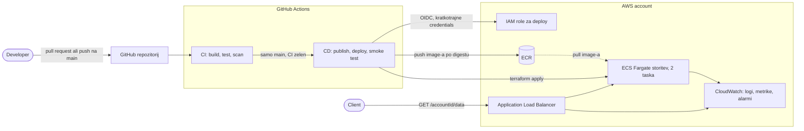

# Specifikacija: storitev z avtomatiziranim CI/CD

Status: osnutek pred začetkom implementacije. Nič od opisanega še ni zgrajeno (glej [razdelek 12](#12-status)).

## 1. Cilj in obseg

Želim narediti preprosto production HTTP storitev, pri kateri gre **vsaka sprememba skozi CI/CD pipeline** in se po uspešnih testih **samodejno deploya v production**.

Naloga ([DevOps_Homework.pdf](DevOps_Homework.pdf)) ima štiri zahteve:

| #   | Zahteva                                                                                                          | Kje je obravnavana                     |
| --- | ---------------------------------------------------------------------------------------------------------------- | -------------------------------------- |
| 1   | Ena GET pot `/<accountId>/data` z odgovorom `{accountId, timestamp, data}` in testi, ki tečejo pred productionom | [3](#3-storitev), [10](#10-testiranje) |
| 2   | Celotna storitev v enem Docker image-u, brez zunanjih dependencies in trajnega shranjevanja                      | [4](#4-docker-image)                   |
| 3   | CI zgradi image in požene teste; build in test sta ločena koraka                                                 | [5](#5-ci-github-actions)              |
| 4   | CD po uspešnem CI deploya storitev v production                                                                  | [6](#6-cd)                             |

**V obsegu (MVP):** storitev, image, pipeline, infrastructure as code, osnovni monitoring.

**Zunaj obsega:** HTTPS in lastna domena, staging okolje, autoscaling, WAF, Grafana Cloud. Vse to navajam kot možne nadgradnje v [razdelku 13](#13-nadaljnje-izboljšave).

**Izbran stack:** Go, Docker, GitHub Actions, Terraform, AWS (ECR, ECS Fargate, ALB, CloudWatch). Razloge za vsako izbiro sem zapisal v [docs/ODLOCITVE.md](ODLOCITVE.md).

## 2. Arhitektura



**Potek:** pull request požene samo CI. Merge v `main` požene CI in, če je zelen, CD. CD objavi **isti image, ki je prestal teste**, ga s Terraformom deploya na ECS Fargate in na koncu preveri delujočo storitev. Če novi taski ne postanejo healthy, ECS samodejno naredi rollback na prejšnjo verzijo.

## 3. Storitev

Majhna storitev v Go, samo s standardno knjižnico (`net/http`). Razlogi: [odločitev 1](ODLOCITVE.md#1-go-za-storitev).

| Pot                     | Obnašanje                                                 |
| ----------------------- | --------------------------------------------------------- |
| `GET /{accountId}/data` | Vrne JSON spodaj, status 200                              |
| `GET /healthz`          | Vrne 200 `ok`; uporabljata ga load balancer in smoke test |
| vse ostalo              | 404, za napačno metodo na znani poti 405                  |

Odgovor ([odločitev 7](ODLOCITVE.md#7-oblika-odgovora)):

```json
{
  "accountId": "acme-42",
  "timestamp": 1767323045,
  "data": "9f2c1e5a7b0d4c3e8a6f1b2d3c4e5f60"
}
```

- `accountId` povzamem iz poti. Veljati mora `^[A-Za-z0-9_-]{1,64}$`, sicer vrnem 400.
- `timestamp` je Unix time v sekundah. Unix time je definiran glede na UTC, zato ni dvoumnosti glede timezone-a.
- `data` je 16 naključnih bajtov iz kriptografskega vira operacijskega sistema, zapisanih v hex.
- Vsak odgovor ima `Cache-Control: no-store`, ker je vedno dinamičen.

Delovanje: JSON logi na stdout, port iz spremenljivke `PORT` (privzeto 8080), graceful shutdown ob SIGTERM, da rolling deploy ne prekine zahtevkov v teku.

## 4. Docker image

Multi-stage Dockerfile ([Docker multi-stage](https://docs.docker.com/build/building/multi-stage/)):

1. **Builder:** uradni `golang` image, statičen build (`CGO_ENABLED=0`), `-trimpath`, odstranjeni simboli.
2. **Runtime:** `gcr.io/distroless/static-debian12:nonroot`. Nima shella ne package managerja, zato je attack surface majhen, proces pa teče kot non-root user.

Base image pinnam na **digest**, posodablja ga Dependabot. Image ne potrebuje zunanjih dependencies ne trajnega shranjevanja.

## 5. CI (GitHub Actions)

Workflow `ci.yml` teče ob vsakem pull requestu in vsakem pushu na `main`. Joba sta **ločena**, da sta build in test ločena koraka, kot zahteva naloga ([odločitev 4](ODLOCITVE.md#4-build-enkrat-promocija-po-digestu)).

| Job     | Potrebuje | Kaj naredi                                                                                                                                                    |
| ------- | --------- | ------------------------------------------------------------------------------------------------------------------------------------------------------------- |
| `build` | /         | Enkrat zgradi image in ga naloži kot artifact (tar image-a)                                                                                                   |
| `test`  | `build`   | Požene `gofmt`, `go vet` in `go test -race`. Nato naloži **isti artifact**, zažene container ter preveri `/healthz` in `/{id}/data` glede na dogovorjeni JSON |
| `scan`  | `build`   | S Trivy pregleda isti image; pade ob HIGH ali CRITICAL ranljivostih, za katere obstaja fix                                                                    |

Supply chain: third-party actions pinnam na **polni commit SHA**, privzeti `permissions` workflowa so samo read, Dependabot spremlja GitHub Actions, Go module in Dockerfile.

## 6. CD

Workflow `cd.yml` teče samo ob pushu na `main` in samo če je CI na istem commitu uspel.

| Job          | Kaj naredi                                                                                                    |
| ------------ | ------------------------------------------------------------------------------------------------------------- |
| `publish`    | Prenese testirani artifact in ga pushne v ECR. Zabeleži **digest** image-a                                    |
| `deploy`     | Teče v GitHub environmentu `production`. Požene `terraform apply` z digestom kot vhodno spremenljivko         |
| `smoke-test` | Pokliče `/healthz` in `/{id}/data` na naslovu ALB (output iz Terraforma); če odgovor ni po dogovoru, run pade |

- **Brez dolgoživih ključev.** Jobi dobijo kratkotrajne AWS credentials s prevzemom IAM role prek GitHub OIDC ([odločitev 5](ODLOCITVE.md#5-github-oidc-namesto-aws-ključev)). Trust policy role-a omejim na ta repozitorij in environment `production`.
- **Promocija, ne ponoven build.** V production gre digest, ki je prestal teste.
- **Rollback.** ECS storitev ima vklopljen deployment circuit breaker z rollbackom. Slabo spremembo lahko vrnem tudi z revertom v Gitu, ki gre skozi isti pipeline.
- **En deploy naenkrat.** `concurrency` group prepreči, da bi dva deploya hkrati pisala v Terraform state.

## 7. Infrastruktura (Terraform)

Dva ločena root modula ([odločitev 2](ODLOCITVE.md#2-terraform-namesto-cdk), [odločitev 8](ODLOCITVE.md#8-struktura-terraforma-in-state)).

**`infra/bootstrap`** poženem **enkrat, ročno**. Ustvari tisto, kar pipeline potrebuje sam:

- S3 bucket za Terraform state (versioning, encryption, blokiran public access) z native lockingom prek S3 lockfile,
- GitHub OIDC identity provider,
- IAM role za deploy.

**`infra/service`** poganja **pipeline** ob vsakem deployu:

| Resource                      | Opomba                                                                                                       |
| ----------------------------- | ------------------------------------------------------------------------------------------------------------ |
| VPC, 2 AZ, public subnets     | Brez NAT gatewaya za MVP ([odločitev 6](ODLOCITVE.md#6-public-subnets-brez-nat))                             |
| ECR repozitorij               | Scan on push, immutable tags, lifecycle policy za brisanje starih image-ov                                   |
| ECS cluster + Fargate service | 2 taska v 2 AZ, circuit breaker z rollbackom, Container Insights ([odločitev 3](ODLOCITVE.md#3-ecs-fargate)) |
| ALB + target group + listener | Health check na `/healthz`; za MVP port 80                                                                   |
| Security groups               | Taski sprejemajo promet samo iz security groupa ALB                                                          |
| CloudWatch log group          | Retention izrecno nastavljen na 14 dni                                                                       |
| IAM roli (task in execution)  | Least privilege; task role nima pravic, ker aplikacija ne kliče AWS API-jev                                  |
| CloudWatch alarmi             | Glej razdelek 8                                                                                              |

Verzije Terraforma in providerjev pinnam, `.terraform.lock.hcl` je v repozitoriju.

## 8. Monitoring

- **Logi:** aplikacija piše JSON na stdout, `awslogs` driver jih pošilja v CloudWatch Logs.
- **Metrike:** ALB in ECS metrike v CloudWatch ter Container Insights.
- **Alarmi (MVP):** delež 5xx na ALB, število unhealthy hostov in p99 latency. Pošiljanje notifikacij (SNS na e-pošto ali chat) pustim kot spremenljivko.
- **Pozneje:** Grafana Cloud nad CloudWatch ([razdelek 13](#13-nadaljnje-izboljšave)).

## 9. Varnost

Kaj je zaščiteno:

- Brez shranjenih cloud credentials; OIDC z ozko omejenim trustom.
- Distroless image brez root pravic; root filesystem taska je read-only.
- Pinnane actions, base images, Go moduli in Terraform provideri. Posodabljam jih ročno, Dependabot še ni nastavljen (glej razdelek 13).
- ECR scan on push.
- V repozitoriju ni secrets; storitev jih ne potrebuje.

### Kaj je javno dostopno

Service je javen, ker naloga zahteva HTTP service, ki ga kličejo odjemalci. Izpostavljenost je omejena takole:

| Del                   | Dostop z interneta                                  | Zakaj                                                                                                                                              |
| --------------------- | --------------------------------------------------- | -------------------------------------------------------------------------------------------------------------------------------------------------- |
| ALB                   | **Da, z vseh naslovov (`0.0.0.0/0`), samo port 80** | Edina javna vstopna točka                                                                                                                          |
| Taski                 | Ne                                                  | Security group sprejema promet samo iz security groupa ALB, čeprav imajo taski javne IP-je ([odločitev 6](ODLOCITVE.md#6-public-subnets-brez-nat)) |
| Vsi ostali porti      | Ne                                                  | Security groupi privzeto zavrnejo vse, kar ni izrecno dovoljeno                                                                                    |
| Odhodni promet taskov | Samo HTTPS (443)                                    | Dovolj za pull image-a iz ECR in pošiljanje logov                                                                                                  |

### Znane vrzeli, ki jih za MVP sprejemam

- **Brez avtentikacije:** vsak, ki pozna DNS ime ALB, lahko kliče `/<accountId>/data`. Naloga avtentikacije ne zahteva, service pa vrača samo naključen niz, timestamp in validiran `accountId`, torej ni česa razkriti.
- **Brez HTTPS:** promet ni šifriran. Za HTTPS potrebujem ACM certifikat in domeno, ki je nimam.
- **Brez WAF in rate limitinga:** ob veliki količini zahtevkov bi bil glavno tveganje strošek.
- **Edina validacija vhoda** je regex za `accountId` ([odločitev 7](ODLOCITVE.md#7-oblika-odgovora)).

Utemeljitev je v [odločitvi 9](ODLOCITVE.md#9-javen-dostop-brez-avtentikacije-in-https), ukrepi za pravi production pa so v razdelku 13.

## 10. Testiranje

| Raven                        | Kje                 | Kaj dokaže                                                                                     |
| ---------------------------- | ------------------- | ---------------------------------------------------------------------------------------------- |
| Unit testi (`go test -race`) | CI job `test`       | Obnašanje handlerja: oblika odgovora, dinamični podatki, validacija inputa, napake, 404 in 405 |
| Container test               | CI job `test`       | Zgrajen image se zažene, streže obe poti in drži dogovorjeni JSON                              |
| Smoke test                   | CD job `smoke-test` | Deployana storitev za pravim load balancerjem deluje                                           |

V unit testih uporabim fake clock in fake vir naključnosti, da so outputi deterministični. Poseben test preveri, da se pravi output med klici razlikuje.

## 11. Koraki implementacije

Vrstni red dela po tem, ko specifikacijo še enkrat preberem:

1. Storitev in unit testi (`cmd/`).
2. Dockerfile z lokalnim testom containerja.
3. CI workflow (`build`, `test`, `scan`) na brezplačnem GitHub repozitoriju, ki teče zares.
4. Terraform `infra/service`, preverjen s `terraform fmt` in `terraform validate`.
5. Terraform `infra/bootstrap`, preverjen enako.
6. CD workflow; AWS korake napišem, a jih ne morem izvesti.
7. Konfiguracija Dependabota in navodila za zagon v README.
8. Posodobitev razdelka 12 s tem, kar sem res zagnal.

## 12. Status

| Del                               | Status                                                      |
| --------------------------------- | ----------------------------------------------------------- |
| Specifikacija in zapisi odločitev | Napisano                                                    |
| Storitev in unit testi            | Ni začeto                                                   |
| Docker image                      | Ni začeto                                                   |
| CI workflow                       | Ni začeto                                                   |
| Terraform                         | Ni začeto; preverjanje bo samo offline (nimam AWS accounta) |
| CD workflow                       | Ni začeto; brez AWS accounta ga ni mogoče izvesti           |

To tabelo sproti posodabljam, da vedno drži.

## 13. Nadaljnje izboljšave

- **HTTPS:** ACM certifikat, Route 53 zapis, redirect z HTTP na HTTPS.
- **Staging okolje** z ročnim approvalom pred productionom.
- **Private subnets** z NAT ali VPC endpointi, brez javnih IP-jev na taskih.
- **Autoscaling** glede na število zahtevkov ali CPU.
- **Grafana Cloud** za dashboarde in alerte.
- **AWS WAF** pred ALB: rate limiting in osnovna zaščita pred zlorabo.
- **Avtentikacija ali omejitev dostopa:** API key ali JWT, ali pa omejitev vira v security groupu na znane IP naslove.
- **Trivy scan v CI** in **Dependabot** za posodabljanje pinov.
- **Blue/green ali canary deploy** (CodeDeploy) s samodejnim rollbackom ob alarmih.
- **Podpisovanje image-ov** (cosign) in SBOM ob vsakem image-u.

## 14. Viri

| Povezava                                                                                                                                                                           | Zakaj je pomembna                                             |
| ---------------------------------------------------------------------------------------------------------------------------------------------------------------------------------- | ------------------------------------------------------------- |
| [Amazon ECS developer guide](https://docs.aws.amazon.com/AmazonECS/latest/developerguide/Welcome.html)                                                                             | Osnovni pojmi runtime-a: clusterji, servisi, task definitions |
| [ECS deployment circuit breaker](https://docs.aws.amazon.com/AmazonECS/latest/developerguide/deployment-circuit-breaker.html)                                                      | Mehanizem samodejnega rollbacka iz razdelka 6                 |
| [Amazon ECR user guide](https://docs.aws.amazon.com/AmazonECR/latest/userguide/what-is-ecr.html)                                                                                   | Registry image-ov, scan on push, lifecycle policies           |
| [Application Load Balancer](https://docs.aws.amazon.com/elasticloadbalancing/latest/application/introduction.html)                                                                 | Target groupi in health checki                                |
| [IAM OIDC identity providers](https://docs.aws.amazon.com/IAM/latest/UserGuide/id_roles_providers_create_oidc.html)                                                                | AWS stran prijave brez ključev iz CI                          |
| [Container Insights](https://docs.aws.amazon.com/AmazonCloudWatch/latest/monitoring/ContainerInsights.html)                                                                        | ECS metrike brez lastnega agenta                              |
| [GitHub: OIDC v AWS](https://docs.github.com/en/actions/how-tos/security-for-github-actions/security-hardening-your-deployments/configuring-openid-connect-in-amazon-web-services) | GitHub stran prijave brez ključev in pogoji trusta            |
| [GitHub: secure use of Actions](https://docs.github.com/en/actions/reference/security/secure-use)                                                                                  | Zakaj actions pinnam na SHA in zožim permissions              |
| [GitHub: environments za deploy](https://docs.github.com/en/actions/deployment/targeting-different-environments/using-environments-for-deployment)                                 | Environment `production` in njegova protection rules          |
| [Docker multi-stage](https://docs.docker.com/build/building/multi-stage/)                                                                                                          | Majhen končni image brez build orodij                         |
| [Terraform S3 backend](https://developer.hashicorp.com/terraform/language/backend/s3)                                                                                              | Remote state in native locking                                |
| [Terraform AWS provider](https://registry.terraform.io/providers/hashicorp/aws/latest/docs)                                                                                        | Referenca vseh resourcov                                      |
